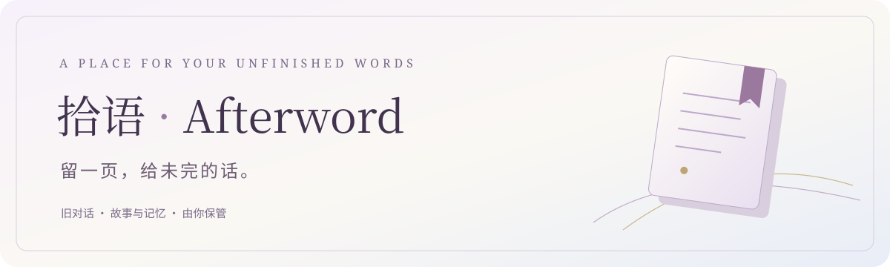

<p align="center">
  
</p>

<p align="center">
  <strong>从上次停下的地方，接着写。</strong><br>
  导入 DeepSeek 对话，把重要的事写进记忆卡，按自己喜欢的方式继续阅读和聊天。
</p>

<p align="center">
  <a href="#开始使用"><strong>开始使用</strong></a>
  &ensp;·&ensp;
  <a href="#自行部署与社区授权">自行部署</a>
  &ensp;·&ensp;
  <a href="#数据与隐私">数据与隐私</a>
  &ensp;·&ensp;
  <a href="#参与开发">参与开发</a>
</p>

<p align="center">
  <sub>独立开源客户端，与 DeepSeek 官方无隶属关系。</sub>
</p>

<p align="center">
  <picture>
    <source media="(prefers-color-scheme: dark)" srcset="docs/assets/app-preview-dark.webp">
    
  </picture>
  <br>
  <sub>「海边书店」是内置虚构示例，打开就能看，无需 API Key。</sub>
</p>

## 给长对话留个位置

- **把旧记录带过来。** 直接导入 DeepSeek 的 ZIP，也支持 JSON、TXT 和 Markdown。从侧边栏重命名、置顶或单独导出对话。编辑旧消息时，可以从「历史版本」找回原来的分支。
- **把重要的事记下来。** 每段对话有自己的记忆卡，可以写人物关系、写作偏好，或给回复换个署名。发送前能查看本轮会带上哪些内容。
- **用舒服的方式读下去。** 浅色、深色、自选配色，字体、字号和行距都能调整。回复支持 Markdown 和点击朗读。也可以带文件、图片或语音草稿来聊，按需开启深度思考和联网。

## 开始使用

需要 **Node.js 22 或更新版本**。克隆仓库并启动社区版：

```bash
git clone https://github.com/Mark-stimulate/Afterword.git
cd Afterword
npm ci
npm run community
cd community
npm start
```

打开 [http://127.0.0.1:4173](http://127.0.0.1:4173)，点「先看看示例」，熟悉界面后再导入自己的记录。

1. **带来一段对话。** 在侧边栏点「导入对话」，选择 DeepSeek 导出的 ZIP，勾选要带来的会话。
2. **补一张记忆卡。** 记下人物、经历，或故事停在了哪里。ZIP 会带来当前分支的文字问答，附件、其他分支和工具结果请保留在原始导出包里。
3. **接着聊。** 在「设置与管理 → 连接与 API 设置」填写自己的 DeepSeek API Key。模型和工具用量由 DeepSeek 计入你的账户。

[查看完整使用指南](docs/getting-started.md)

## 自行部署与社区授权

在仓库根目录运行 `npm ci` 和 `npm run build:community`，将生成的 `dist/` 目录部署到 Cloudflare Pages、1Panel 或其他支持 HTTPS 的静态托管。平台的构建命令和目录设置见 [自行部署指南](docs/deployment.md)。

**社区授权免费、无到期日，适用于 0.x 版本。** 在「设置与管理 → 高级功能 · 授权」导入 [社区免费授权文件](examples/社区免费授权.license)，即可解锁全文与记忆搜索，以及保存和套用记忆模板。

## 数据与隐私

| 内容 | 数据去向 |
| --- | --- |
| 对话、记忆卡和导入的 ZIP | 记录保存在当前浏览器和站点。ZIP 由浏览器解析。 |
| 本轮消息和上下文 | 发送时，选中的近期对话、启用的记忆和本轮附件由浏览器直传 DeepSeek。 |
| API Key | 默认在浏览器中未加密保存，可改用密码加密。调用时发往 DeepSeek。 |
| 备份 | 可导出明文或密码加密文件。备份不含 API Key，文档只保留名称和引用。 |

换设备或清理网站数据前，先在「备份与恢复」保存一份备份。[查看隐私与备份说明](docs/privacy.md)

## 参与开发

欢迎从移动端体验、导入兼容性和文档改起。用内置示例即可检查阅读、主题和备份，无需申请 API Key。修改后可在仓库根目录运行 `npm test`，再用 `npm run build:community` 检查社区构建。

[开发说明](docs/development.md) · [贡献指南](CONTRIBUTING.md) · [测试状态](https://github.com/Mark-stimulate/Afterword/actions/workflows/check.yml) · [安全说明](SECURITY.md)

拾语源码采用 [MIT 许可证](LICENSE)，聊天能力通过 [DeepSeek 官方 API](https://api-docs.deepseek.com/) 提供。API 接入示例见 [DeepSeek 官方开源演示 chat-demo](https://github.com/deepseek-ai/chat-demo)。

[报告问题](https://github.com/Mark-stimulate/Afterword/issues)时，请使用虚构或脱敏样例，避免提交私人对话或真实 API Key。
