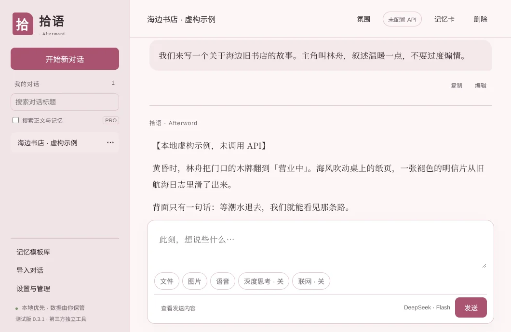

<p align="center">
  
</p>

<p align="center">
  <b>把旧对话拾回来，让故事慢慢继续。</b><br>
  导入 DeepSeek 对话，把重要的事写进记忆卡，在自己的浏览器里继续聊。<br>
  独立开源客户端，与 DeepSeek 官方无隶属关系。
</p>

<p align="center">
  <a href="#开始使用">开始使用</a> ·
  <a href="docs/getting-started.md">使用指南</a> ·
  <a href="docs/deployment.md">自行部署</a> ·
  <a href="docs/privacy.md">数据与隐私</a>
</p>

<p align="center">
  <a href="https://github.com/Mark-stimulate/Afterword/actions/workflows/check.yml"></a>
  <a href="LICENSE"></a>
</p>

## 开始使用

需要 Node.js 22 或更新版本。在仓库目录运行：

```bash
npm ci
npm run community
cd community
npm start
```

打开 [http://127.0.0.1:4173](http://127.0.0.1:4173)。从「先看看示例」开始，无需 API Key。

1. **导入旧对话。** 直接选择 DeepSeek 导出的 ZIP，预览并勾选要导入的对话。
2. **写一张记忆卡。** 记下人物关系、重要经历，或故事停在了哪里。每段对话可以用自己的记忆卡。
3. **接着聊。** 在「设置与管理 → 连接与 API 设置」填写自己的 DeepSeek API Key，发送前可以预览本轮会带上的内容。模型和工具用量由 DeepSeek 计入你的账户。



## 你可以用拾语做什么

| 想做的事 | 去哪里 |
| --- | --- |
| 迁移、整理旧对话 | 在侧边栏导入 ZIP、JSON、TXT、Markdown 或拾语备份。每段对话的「…」菜单可重命名、置顶和单独导出。 |
| 延续人物与故事 | 用记忆卡保存设定，自定义这段对话的回复署名。编辑旧消息后，原对话可以从「历史版本」查看。 |
| 用舒服的方式阅读 | 在「颜色与阅读」预览浅色和深色主题，调整字体、字号和行距。回复支持 Markdown 和点击朗读。 |
| 聊文件、图片和网页 | 从输入框添加文件、图片或录音。录音可转成文字草稿。按需开启深度思考或联网。 |
| 保留自己的副本 | 在「备份与恢复」导出明文或密码加密备份，换设备时用文件恢复。 |

**免费社区授权**可解锁全文和记忆搜索，以及保存、套用记忆模板。在「设置与管理 → 高级功能 · 授权」下载并导入 [社区免费授权.license](examples/社区免费授权.license)，点击「验证并解锁」。社区授权无到期日，适用于 0.x 版本。

## 自行部署

| 环境 | 构建与运行 |
| --- | --- |
| 本机 | 按上方「开始使用」的命令运行。 |
| Cloudflare Pages | Node.js 22 或更新版本。构建命令 `npm ci && npm test && npm run build:community`，输出目录 `dist`。 |
| 1Panel 或其他静态托管 | 运行 `npm ci` 和 `npm run build:community`，以 HTTPS 托管 `dist` 里的文件。 |

→ [完整部署指南](docs/deployment.md) · [源码结构与测试](docs/development.md)

## 数据与使用边界

- **本地保存。** 对话和记忆保存在当前浏览器和站点。ZIP 在本机解析。清理网站数据或换设备前，先导出备份。
- **直接连接 DeepSeek。** 发送时，浏览器把本轮内容、选中的近期历史及启用的记忆发送至官方 API。附件在发送时上传，备份只保留文档名称和引用，请留好原件。
- **API Key 单独管理。** 默认以未加密的方式保存在当前浏览器，可改用密码加密。聊天备份不包含 Key。
- **旧对话的迁移范围。** ZIP 导入保留当前分支的文字问答。附件、其他分支和工具结果请留在原始导出包中。续聊时，你可以把要延续的背景整理进记忆卡。

→ [隐私、备份与换设备说明](docs/privacy.md) · [支持格式和常见问题](docs/getting-started.md)

## 相关项目与许可

拾语通过 [DeepSeek 官方 API](https://api-docs.deepseek.com/)提供聊天能力。想了解官方的 API 使用示例，可以查看 [DeepSeek 官方开源演示 chat-demo](https://github.com/deepseek-ai/chat-demo)。拾语源码采用 [MIT 许可证](LICENSE)。

欢迎用虚构样例报告问题。请勿在公开 Issue 中提交真实 API Key 或私人对话。

[报告问题](https://github.com/Mark-stimulate/Afterword/issues) · [贡献指南](CONTRIBUTING.md) · [安全说明](SECURITY.md)
